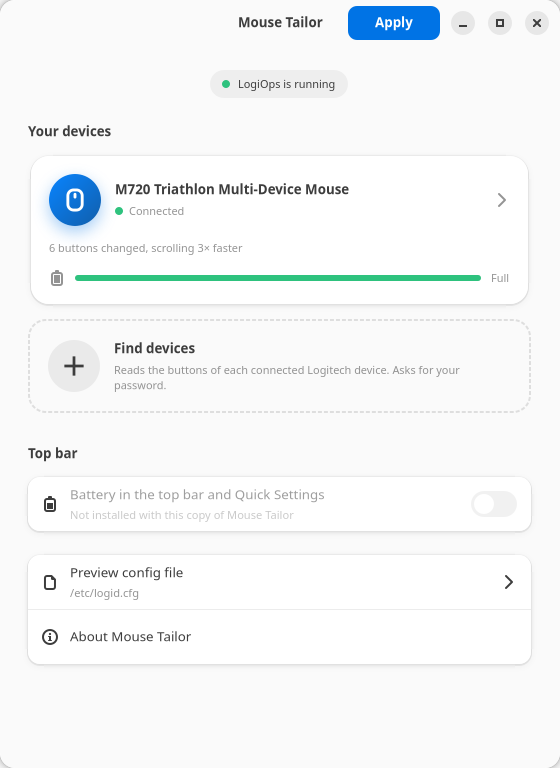
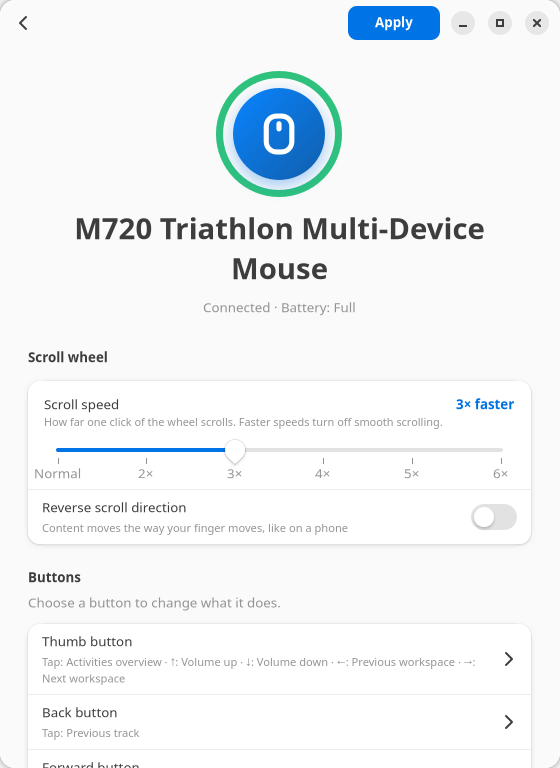
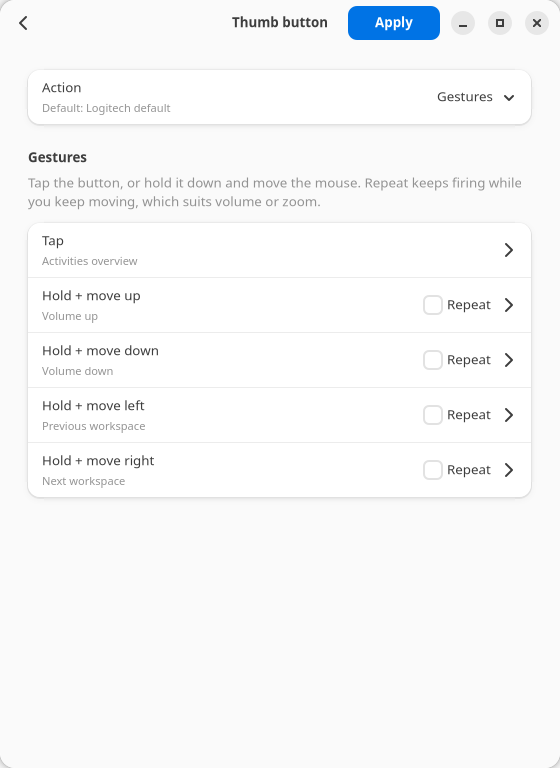
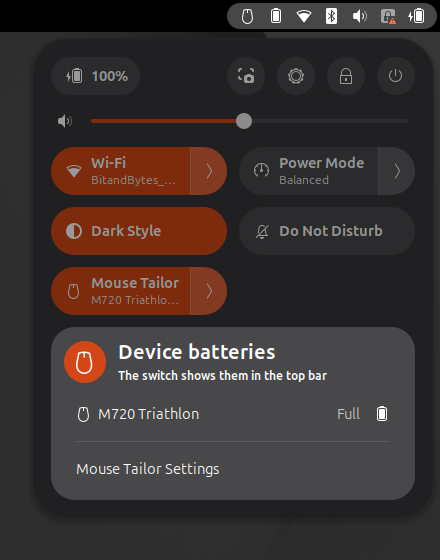

# Mouse Tailor

Tailor your Logitech mouse on Linux: pick what each button does, set up hold-and-swipe
gestures, change scroll speed and direction, and keep an eye on the battery from the top bar.
No config files to edit.

Mouse Tailor is a graphical front end for [LogiOps](https://github.com/PixlOne/logiops),
the unofficial Logitech driver that does the work in the background.

<p>
  
  
  
</p>
<p>
  
</p>

## What it can do

- **Remap buttons** to a shortcut: switch workspaces, volume, play/pause, copy/paste,
  browser tabs, or any key combination you record.
- **Gestures**: tap a button, or hold it and move the mouse up, down, left or right.
  Each direction gets its own action, and can repeat while you keep moving (handy for volume).
- **Scroll speed**: make each click of the wheel scroll 2 to 6 times further.
- **Reverse scrolling** for one mouse, without changing your other mice or touchpad.
- **Battery** for each device in the app, in the top bar, and in a Quick Settings tile.
- **Any LogiOps-supported device**: *Find devices* reads the buttons of every connected
  Logitech mouse, so you don't need to know button IDs.

## Install

### Ubuntu 24.04+ and Debian 13+

Download `mouse-tailor_1.1.0_all.deb` from the [Releases page](https://github.com/faizankhan63/mouse-tailor/releases/latest), then double-click it, or run:

```bash
sudo apt install ./mouse-tailor_1.1.0_all.deb
```

This also installs LogiOps and everything else it needs. Open **Mouse Tailor** from your app menu.
If you had the earlier *Mouse Setup* version, it's replaced and your settings carry over.

### Other distributions

Install the dependencies:

| Distribution | Dependencies |
|---|---|
| Fedora | `sudo dnf install logiops python3-gobject gtk4 libadwaita python3-evdev upower` |
| Arch | `sudo pacman -S python-gobject gtk4 libadwaita python-evdev upower` and `logiops` from the AUR |

Then download this repository and run its install script:

```bash
git clone https://github.com/faizankhan63/mouse-tailor.git
cd mouse-tailor
./install.sh
```

Remove it again with `./install.sh --uninstall`.

## How to use it

1. Turn your mouse on and open **Mouse Tailor**.
2. If your mouse isn't listed, choose **Find devices** and enter your password.
   Move the mouse while it looks, so it doesn't fall asleep.
3. Choose your mouse, then change its scroll wheel or a button.
4. Press **Apply** and enter your password. The new settings take effect right away
   and stay after a reboot.

The Logitech M720 Triathlon is recognised without *Find devices*.

### Battery in the top bar

Turn on **Battery in the top bar and Quick Settings** in Mouse Tailor. The first time, log out
and back in: GNOME only picks up newly installed extensions at login. After that you'll see your
mouse's battery next to the system icons, and a **Mouse Tailor** tile in Quick Settings
(the menu at the top right). The tile's switch hides or shows the top-bar icon.

Some mice, like the M720, only report a level (Full, High, Normal, Low, Critical) instead of
a percentage.

## How it works

- Your choices are saved in `~/.config/mouse-tailor/settings.json`.
- **Apply** turns them into `/etc/logid.cfg` and restarts the `logid` service.
  The first time, your old `logid.cfg` is kept as `/etc/logid.cfg.bak`.
- **Find devices** stops `logid` for a few seconds, runs it in verbose mode to list
  each device's remappable buttons, then starts it again.
- Both need root, so they go through a small helper
  (`/usr/libexec/mouse-tailor/mouse-tailor-helper`) that polkit asks your password for.
  The password is remembered for a few minutes.
- Battery levels come from UPower, which reads them from the Linux kernel. No password needed.
- The top bar and Quick Settings come from a GNOME Shell extension that ships with the app
  (`mouse-tailor@mousetailor.github.io`).

If you edit `/etc/logid.cfg` by hand, the next **Apply** replaces it. Mouse Tailor warns
you when it finds a hand-written config.

## Limitations

- **Faster scrolling turns off smooth scrolling** while it's on, and only whole-number speeds work.
  Both work around bugs in LogiOps 0.3 (issues
  [#370](https://github.com/PixlOne/logiops/issues/370) and
  [#427](https://github.com/PixlOne/logiops/issues/427)).
- DPI and SmartShift settings aren't in the app yet.
- Shortcuts the desktop already uses (Alt+Tab, Super, …) can't be recorded, because
  GNOME takes them first. They're in the preset list instead.
- The preset desktop shortcuts are GNOME's defaults. On other desktops, record your own.
- The Easy-Switch button is left alone, so switching between computers keeps working.
- The top-bar extension is tested on GNOME Shell 50. It's marked compatible with 46 to 49,
  which have the same APIs, but hasn't been tried there.

## Building the .deb

```bash
./build-deb.sh
```

The package lands in `dist/`. It uses your git name and email as the maintainer;
set `MAINTAINER="Name <email>"` to use something else.

## Run from source

```bash
/usr/bin/python3 src/mouse_tailor.py
```

## Credits and license

MIT licensed; see [LICENSE](LICENSE). Mouse Tailor depends on
[LogiOps](https://github.com/PixlOne/logiops) by PixlOne and contributors (GPL-3.0),
which it runs as a separate program.

Logitech and the Logitech logo are trademarks of Logitech Europe S.A. Mouse Tailor is an
independent project, not affiliated with or endorsed by Logitech.
